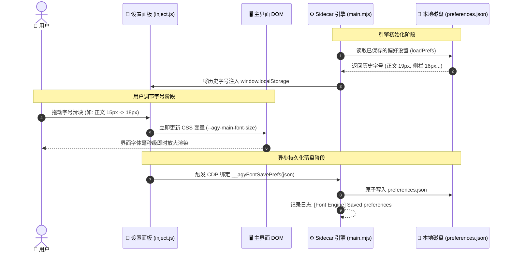
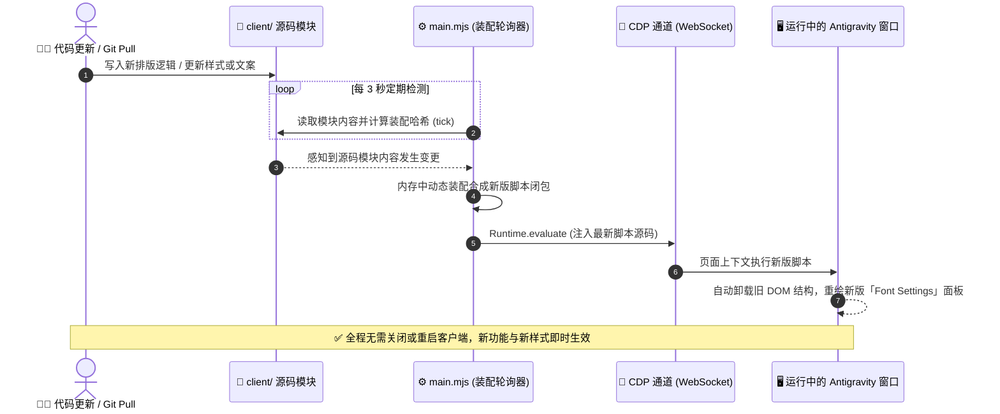

# 系统架构与实现原理 (System Architecture)

本项目为 Antigravity 桌面客户端提供非侵入式的细粒度字体与排版定制能力。无需解包客户端二进制或修改 `app.asar`，利用 Antigravity 原生 Sidecar 运行机制与 Chrome DevTools Protocol (CDP) 调试桥接，实现排版样式的即时动态注入、毫秒级响应、双向数据持久化与免重启热重载。

---

## 1. 系统总体架构 (System Architecture)

整个系统由 **宿主层 (Host)**、**引擎层 (Sidecar Engine)**、**注入层 (Page Renderer)** 与 **数据持久化层 (Storage)** 四部分组成：

---

## 2. 核心交互与持久化时序 (Lifecycle & Persistence Sequence)

用户在设置面板中调整字体时，样式修改与本地落盘采用“界面零延迟响应 + 后台异步持久化”的双轨设计：

---

## 3. 免重启热重载机制 (Hot-Reloading Sequence)

当开发者修改了 `client/` 下的样式（`styles.css`）、文案（`i18n.js`）或交互逻辑（`panel.js`），或用户通过版本管理拉取了最新代码时，系统通过 CDP 自动执行热重载，无需关闭或重启 Antigravity 宿主：

---

## 4. 关键设计原则与隔离规范

1. **非侵入原则**：完全依赖官方 Sidecar 规范与 CDP 调试协议，不修改 Electron 安装目录的任何系统文件或 ASAR 归档。
2. **样式作用域隔离**：
   - 侧边栏字号仅作用于主界面工作区（项目树、会话列表）；
   - 设置弹窗自身的侧栏字体严格锁定为原生 `14px`，确保打开设置窗口时布局始终稳定，防止递归变形；
   - 用户发送消息气泡与 AI 响应气泡建立统一样式选择器同步约束。
3. **环境无关性与零依赖**：
   - 管理脚本 [`manage.py`](manage.py) 完全基于 Python 3 标准库，无需通过 pip 安装第三方依赖；
   - 彻底卸载时执行 5 步清理，同步清除插件软链接、`config.json` 注册表、`sidecar_data` 缓存及 `plugin_data` 残留目录，确保系统零残留。
