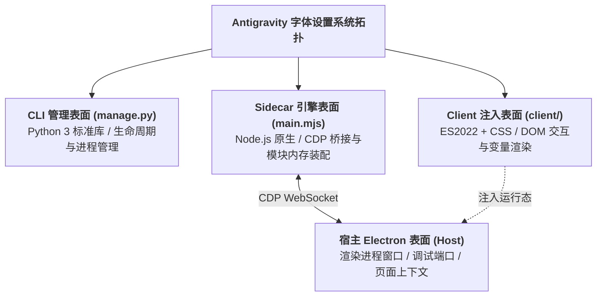
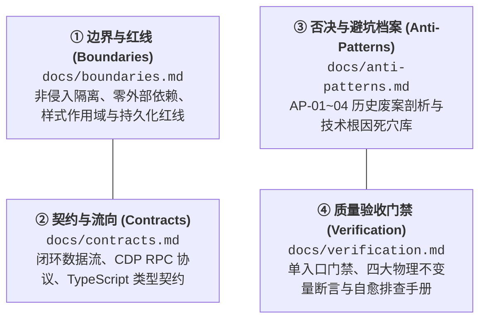
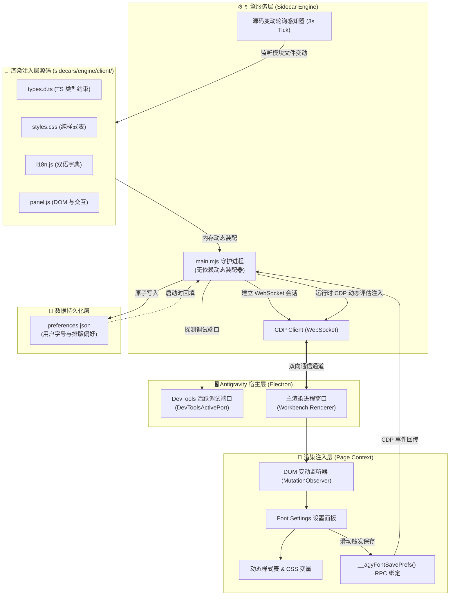
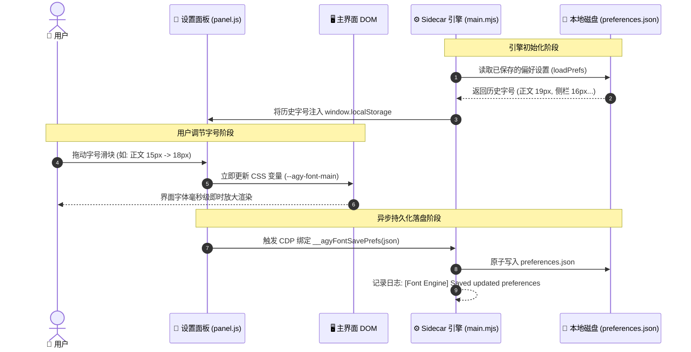
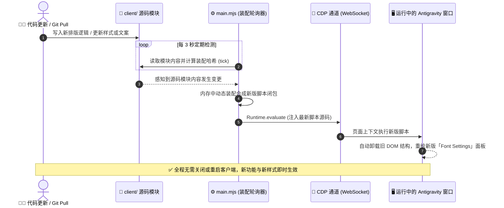

# 系统架构指南 (System Master Architecture)

本项目为 Antigravity 桌面客户端提供非侵入式的细粒度字体与排版定制能力。无需解包客户端二进制或修改 `app.asar`，利用 Antigravity 原生 Sidecar 运行机制与 Chrome DevTools Protocol (CDP) 调试桥接，实现排版样式的即时动态注入、毫秒级响应、双向数据持久化与免重启热重载。

---

## 1. 意图-文档路由索引表 (Documentation Sitemap)

> [!IMPORTANT]
> **新会话启动防失忆协议**：在新会话开启时，智能体根据具体改动意图，直接查阅下表定位责任物理目录与受信任规范文档，严禁盲目修改！

| 变动诉求 / 业务意图 | 责任物理目录 / 表面 | 唯一受信任业务契约 (Spec) | 严禁触碰的边界文件 / 物理红线 |
| :--- | :--- | :--- | :--- |
| **调整字号/行高/样式规则** | [`sidecars/engine/client/styles.css`](file:///Users/yemou/Documents/extentions/Antigravity-font-settings/sidecars/engine/client/styles.css) | [`docs/boundaries.md`](file:///Users/yemou/Documents/extentions/Antigravity-font-settings/docs/boundaries.md) | 严禁删除 `:not([role="dialog"] *)` 隔离限定；严禁在原生 CSS 中使用双反斜杠转义 |
| **新增/调整设置项与滑块交互** | [`sidecars/engine/client/panel.js`](file:///Users/yemou/Documents/extentions/Antigravity-font-settings/sidecars/engine/client/panel.js) | [`docs/contracts.md`](file:///Users/yemou/Documents/extentions/Antigravity-font-settings/docs/contracts.md) | 严禁引入外部框架；必须同步更新 `types.d.ts` 与 `i18n.js` |
| **更新多语言文案字典** | [`sidecars/engine/client/i18n.js`](file:///Users/yemou/Documents/extentions/Antigravity-font-settings/sidecars/engine/client/i18n.js) | [`sidecars/engine/client/types.d.ts`](file:///Users/yemou/Documents/extentions/Antigravity-font-settings/sidecars/engine/client/types.d.ts) | 保持中英文字段键值严格对称；侧栏主标题锁定英文 `Font Settings` |
| **CDP 通信与热重载装配** | [`sidecars/engine/main.mjs`](file:///Users/yemou/Documents/extentions/Antigravity-font-settings/sidecars/engine/main.mjs) | [`docs/contracts.md`](file:///Users/yemou/Documents/extentions/Antigravity-font-settings/docs/contracts.md) | 严禁引入 npm 依赖；必须保持 `Page.addScriptToEvaluateOnNewDocument` 自愈机制 |
| **插件生命周期与安装卸载** | [`manage.py`](file:///Users/yemou/Documents/extentions/Antigravity-font-settings/manage.py) | [`docs/boundaries.md`](file:///Users/yemou/Documents/extentions/Antigravity-font-settings/docs/boundaries.md) | 严禁引入第三方 pip 依赖；彻底卸载必须执行 5 步全闭环清理 |
| **质量验收与不变量验证** | [`sidecars/engine/test_e2e.mjs`](file:///Users/yemou/Documents/extentions/Antigravity-font-settings/sidecars/engine/test_e2e.mjs) | [`docs/verification.md`](file:///Users/yemou/Documents/extentions/Antigravity-font-settings/docs/verification.md) | 严禁降低规则数基线（$\ge 36$）；必须保持代码与正文 1:1 断言 |

---

## 2. 表面隔离与拓扑矩阵 (Multi-Surface Isolation Matrix)

| 表面标识 | 物理目录 | 运行环境与权限沙箱 | 交付载体 | 专用验证门禁 |
| :--- | :--- | :--- | :--- | :--- |
| **CLI 管理端** | [`manage.py`](file:///Users/yemou/Documents/extentions/Antigravity-font-settings/manage.py) | 本地操作系统 / Python 3 原生 | 独立命令行终端 | `uv run manage.py status` |
| **Sidecar 引擎** | [`sidecars/engine/main.mjs`](file:///Users/yemou/Documents/extentions/Antigravity-font-settings/sidecars/engine/main.mjs) | 后台守护进程 / Node.js 原生 | 官方 Sidecar 进程 | `node sidecars/engine/main.mjs` |
| **渲染注入层** | [`sidecars/engine/client/`](file:///Users/yemou/Documents/extentions/Antigravity-font-settings/sidecars/engine/client/) | Electron 渲染上下文 / 浏览器沙箱 | 动态注入脚本闭包 | `node sidecars/engine/test_e2e.mjs` |

---

## 3. 四维工程真理库索引 (The 4 Pillars of Architecture)

跨表面通用的系统架构知识严格按照四维真理库进行分治维护：

* **[① 边界与红线 (docs/boundaries.md)](docs/boundaries.md)**：涉及模块重构、权限边界划分、引入外部工具或处理样式隔离时必读；
* **[② 契约与流向 (docs/contracts.md)](docs/contracts.md)**：涉及接口变更、偏好字段扩展、CDP 协议通信或样式变量扩展时必读；
* **[③ 否决与避坑档案 (docs/anti-patterns.md)](docs/anti-patterns.md)**：排查渲染失效、修改 CSS 转义或调整注入生命周期前必读，严禁重复引入历史废案；
* **[④ 质量验收门禁 (docs/verification.md)](docs/verification.md)**：完成任何代码修改交付前必须阅读并执行门禁命令。

---

## 4. 系统总体架构 (System Architecture)

整个系统由 **宿主层 (Host)**、**引擎层 (Sidecar Engine)**、**注入层 (Page Renderer)** 与 **数据持久化层 (Storage)** 四部分组成：

---

## 5. 核心交互与持久化时序 (Lifecycle & Persistence Sequence)

用户在设置面板中调整字体时，样式修改与本地落盘采用“界面零延迟响应 + 后台异步持久化”的双轨设计：

---

## 6. 免重启热重载机制 (Hot-Reloading Sequence)

当开发者修改了 `client/` 下的样式（`styles.css`）、文案（`i18n.js`）或交互逻辑（`panel.js`），系统通过 CDP 自动执行热重载，无需关闭或重启 Antigravity 宿主：

---

## 7. 关键设计原则与隔离规范

1. **非侵入原则**：完全依赖官方 Sidecar 规范与 CDP 调试协议，不修改 Electron 安装目录的任何系统文件或 ASAR 归档。
2. **样式作用域隔离**：
   - 侧边栏字号仅作用于主界面工作区（项目树、会话列表）；
   - 设置弹窗自身的侧栏字体严格锁定为原生 `14px`，确保打开设置窗口时布局始终稳定，防止递归变形；
   - 用户发送消息气泡与 AI 响应气泡建立统一样式选择器同步约束。
3. **环境无关性与零依赖**：
   - 管理脚本 [`manage.py`](manage.py) 完全基于 Python 3 标准库，无需通过 pip 安装第三方依赖；
   - 彻底卸载时执行 5 步清理，同步清除插件软链接、`config.json` 注册表、`sidecar_data` 缓存及 `plugin_data` 残留目录，确保系统零残留。
