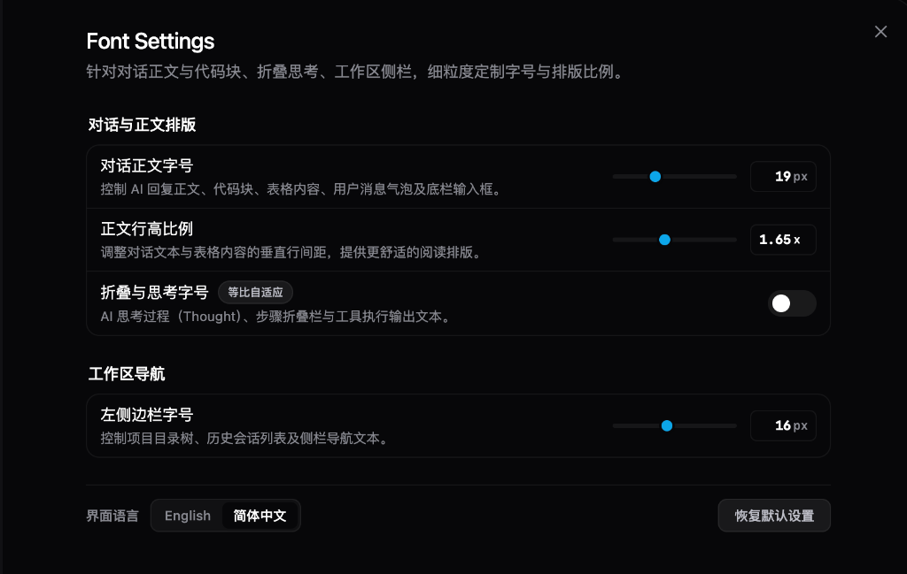

<div align="center">


# Antigravity Font Settings

**细粒度定制 Google Antigravity 桌面客户端字体大小与排版的轻量级扩展**

[](CHANGELOG.md)
[](LICENSE)
[](#快速安装-quick-installation)

</div>

---

## 效果预览



---

## 快速安装 (Quick Installation)

复制以下命令并在终端中执行，即可通过一键脚本自动完成下载、注册与启用：

### 🍎 macOS / Linux

```bash
curl -fsSL https://raw.githubusercontent.com/moumouye/Antigravity-font-settings/main/install.sh | bash
```

### 🪟 Windows

**PowerShell（推荐）**：
```powershell
irm https://raw.githubusercontent.com/moumouye/Antigravity-font-settings/main/install.ps1 | iex
```

*CMD / `curl.exe` 方式*：
```cmd
curl.exe -fsSL https://raw.githubusercontent.com/moumouye/Antigravity-font-settings/main/install.ps1 | powershell -
```

---

### 🚀 使用方法

1. **执行安装**：在系统终端中运行上述对应系统的一键安装命令；
2. **重启客户端**：完全退出并重新打开 Antigravity 桌面应用；
3. **打开设置调节**：
   - 按下快捷键 `Cmd+,`（macOS）或 `Ctrl+,`（Windows）；
   - 在左侧导航菜单中点击 **「Font Settings」** 即可实时调整。

---

## 一键卸载 (Quick Uninstall)

若需完全卸载插件并彻底恢复 Antigravity 默认外观，运行以下命令即可全自动终止后台进程、注销配置并清除所有数据残留（零残留清理）：

### 🍎 macOS / Linux
```bash
curl -fsSL https://raw.githubusercontent.com/moumouye/Antigravity-font-settings/main/uninstall.sh | bash
```

### 🪟 Windows
```powershell
irm https://raw.githubusercontent.com/moumouye/Antigravity-font-settings/main/uninstall.ps1 | iex
```
*CMD / `curl.exe` 方式*：
```cmd
curl.exe -fsSL https://raw.githubusercontent.com/moumouye/Antigravity-font-settings/main/uninstall.ps1 | powershell -
```

---

## 核心特性

- **左右双侧独立缩放**：左侧工作区侧边栏（项目树、会话列表）与右侧主工作区（对话正文、输入框、代码块）字号解耦独立控制。
- **细粒度排版参数矩阵**：
  - **侧边栏字号**：`10px ~ 24px`（默认 `14px`）
  - **对话正文字号**：`11px ~ 36px`（默认 `15px`）
  - **代码字号 1:1 严格绑定**：代码块（`pre`、`code`、Monaco 编辑器）字号直接锁定对话正文，等比同步缩放，消除阅读割裂感
  - **折叠与思考字号**：支持独立开关控制；关闭时跟随正文 85% 等比自适应，开启后支持 `9px ~ 24px` 独立微调
  - **正文行高比例**：`1.0 ~ 2.6`（默认 `1.6`）
- **Markdown 排版系统强化**：各级标题（H1~H6）按正文字号梯度梯次递增放大，表格单元格字号与行高与正文严格 1:1 同步，层次分明规整。
- **滑块背景穿透模式 (Ghost Peeking Mode)**：拖拽滑块时遮罩层与弹窗背景全透明穿透，仅保留当前活动滑块与浮动数值胶囊，直视真实排版变化，松开平滑过渡复原。
- **开放自由数值微调**：除平滑滑块外，输入框支持键盘手输任意目标数值并即时生效。
- **双语自适应切换**：支持中文与英文双语一键切换，侧栏导航项与主标题永久锁定官方标准英文「`Font Settings`」，与宿主原生风格保持一致。

---

## 本地手动安装与管理控制台

若已将代码克隆至本地，可直接通过跨平台管理脚本 [`manage.py`](manage.py) 进行管理：

### 1. 启动交互式控制台

```bash
python3 manage.py
```
*(若环境中已配置 `uv`，亦可直接执行 `uv run manage.py`)*

终端将弹出交互式数字菜单，按数字键 `[0-6]` 选择对应操作：

```text
========================================================
         Antigravity 字体设置插件管理器 (v1.1.0)         
========================================================
  [1] 安装并启用插件 (Install)
  [2] 彻底卸载插件 (Uninstall - 清理所有配置与数据)
  [3] 查看当前状态 (Status - 含已存字号与运行状态)
  [4] 启用插件 (Enable - 激活并恢复历史字体设置)
  [5] 禁用插件 (Disable - 暂时停用，保留字体设置)
  [6] 运行自动化全链路测试 (Test)
  [0] 退出管理器 (Exit)
========================================================
```

### 2. 常用命令行指令

| 业务诉求 | 推荐命令 | 行为说明 |
| :--- | :--- | :--- |
| **快速安装并启用** | `python3 manage.py install` | 自动建立软链接并在 `config.json` 中激活 |
| **状态深度诊断** | `python3 manage.py status` | 输出插件安装状态、持久化字号配置、CDP 端口与后台进程 |
| **启用插件** | `python3 manage.py enable` | 恢复插件挂载，自动继承本地已保存的历史字体配置 |
| **停用插件** | `python3 manage.py disable` | 暂停插件并释放后台引擎进程，完整保留字体配置 |
| **运行全链路测试** | `python3 manage.py test` | 执行端到端测试门禁，验证模块装配、CDP 会话与像素渲染 |
| **彻底纯净卸载** | `python3 manage.py uninstall` | 5 步深度清理：移除软链接、注销配置、清除数据缓存与残留 |

---

## 许可证 (License)

本项目采用 [MIT 许可证](LICENSE) 开源发布。
