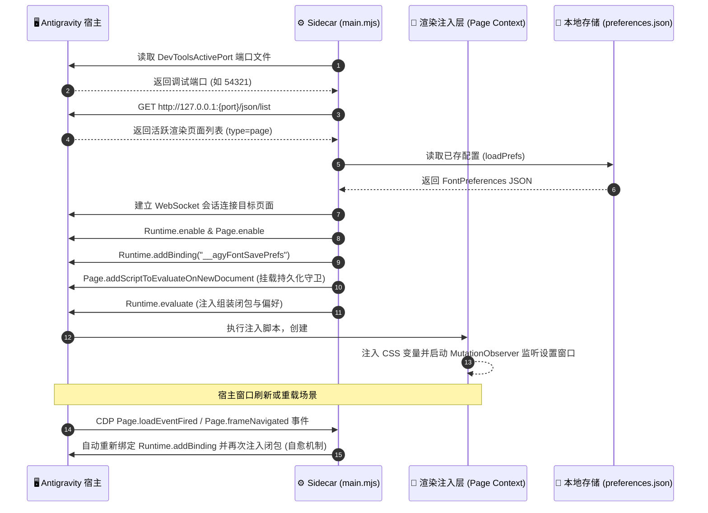

# ② 契约与流向 (Contracts & Data Pipelines)

本文档定义系统的数据流向管道、模块间通信协议、CDP 桥接时序与核心类型契约。

---

## 1. 全局数据流向管道 (Data Flow Architecture)

系统偏好数据采用闭环单向流动设计：

```mermaid
flowchart LR
    Disk["<b>持久化存储 (Disk)</b><br/>preferences.json"]
    Engine["<b>Sidecar 引擎 (Node.js)</b><br/>main.mjs"]
    CDP["<b>CDP 协议通道</b><br/>WebSocket RPC"]
    Page["<b>渲染上下文 (DOM)</b><br/>:root CSS Variables"]
    UI["<b>Font Settings 面板</b><br/>滑块与输入胶囊"]

    Disk -->|1. 启动加载 (loadPrefs)| Engine
    Engine -->|2. 脚本包装注入| CDP
    CDP -->|3. 写入 localStorage 并设置 CSS 变量| Page
    Page -->|4. 初始化当前数值| UI
    UI -->|5. 拖拽滑块 60fps 实时重绘| Page
    UI -->|6. 防抖触发 __agyFontSavePrefs(json)| CDP
    CDP -->|7. Runtime.bindingCalled 事件| Engine
    Engine -->|8. 原子写入落盘 (savePrefs)| Disk
```

---

## 2. 跨进程调用时序协议 (Communication Protocols & Sequences)

### 2.1 启动与生命周期自愈时序



### 2.2 偏好持久化 RPC 契约

| 接口 / 事件名称 | 发起方 | 接收方 | 输入载荷 (Payload) | 契约行为与副作用 |
| :--- | :--- | :--- | :--- | :--- |
| `__agyFontSavePrefs` | Page 渲染注入层 | Sidecar 引擎 | `prefsJson` (序列化的 `FontPreferences` 字符串) | 引擎反序列化验证，通过原子写入落盘至 `preferences.json`。 |
| `Runtime.bindingCalled` | Chrome DevTools | Sidecar 引擎 | `{ name: "__agyFontSavePrefs", payload: string }` | Node.js 端 CDP 客户端分发并触发持久化落盘回调。 |
| `Page.evaluate` | Sidecar 引擎 | Page 渲染注入层 | 包含自执行匿名函数的 JavaScript 字符串 | 在页面上下文动态求值，挂载样式表与面板控制器。 |

---

## 3. 核心数据结构与类型契约 (Type Contracts)

### 3.1 用户排版偏好模型 (`FontPreferences`)

```typescript
/**
 * 用户排版偏好核心实体类型
 */
export interface FontPreferences {
  /** 左侧边栏字号 (px)，合法范围 [10, 24]，默认 14 */
  sidebarFontSize: number;
  /** 右侧主对话区及代码正文字号 (px)，合法范围 [11, 36]，默认 15 */
  mainFontSize: number;
  /** 对话正文行高乘数，合法范围 [1.2, 2.2]，默认 1.6 */
  lineHeight: number;
  /** 是否开启思考过程/折叠栏独立字号控制，默认 false (等比自适应 85%) */
  customThoughtFontSize: boolean;
  /** 独立思考过程/折叠栏字号 (px)，合法范围 [10, 24]，默认 13 */
  thoughtFontSize: number;
  /** 面板显示语言，锁定为 'en' | 'zh' */
  language: 'en' | 'zh';
}
```

### 3.2 CSS 自定义属性驱动契约 (`:root` CSS Variables)

注入层通过在 `:root` 动态注入以下标准 CSS 变量，驱动全局样式重塑：

| CSS 变量名 | 绑定数据源 | 默认基准值 | 驱动作用域 |
| :--- | :--- | :--- | :--- |
| `--agy-font-sidebar` | `prefs.sidebarFontSize` | `14px` | 左侧边栏导航、文件树、会话历史条目 |
| `--agy-font-main` | `prefs.mainFontSize` | `15px` | 对话正文 `p`、用户气泡、AI 回复文本 |
| `--agy-font-code` | 严格绑定 `--agy-font-main` | `var(--agy-font-main)` | 代码块 `pre`、内联 `code`、Monaco 编辑器 |
| `--agy-font-thought` | `custom ? thoughtFontSize : main * 0.85` | `calc(var(--agy-font-main) * 0.85)` | 思考过程折叠条、步骤折叠容器正文 |
| `--agy-font-line-height`| `prefs.lineHeight` | `1.6` | 对话正文行距 |

### 3.3 源码模块热装配契约 (Module Packaging Contract)

后台引擎在感知到 `client/` 变动时，按以下物理顺序在内存中合成为单自执行闭包，不借助外部打包器：

```javascript
(() => {
  // 1. Client Stylesheet (由 styles.css 转义字符串注入)
  const CLIENT_STYLES = "...";

  // 2. 双语字典定义 (i18n.js 剔除 export 前缀)
  // 3. 面板控制器与 DOM 事件 (panel.js 剔除 export 前缀)

  // 4. 入口初始化调用
  if (typeof initClient === 'function') {
    initClient(CLIENT_STYLES, DEFAULT_PREFS, getTexts);
  }
})();
```
