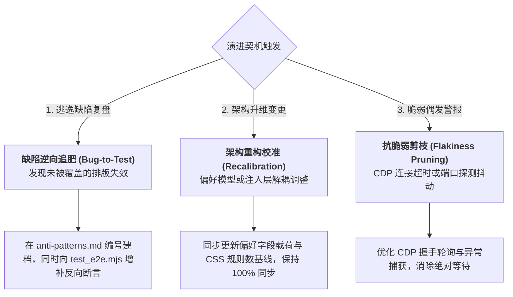

# ④ 质量验收门禁与演进标准 (Verification Gate & Invariant Standards)

本文档定义系统交付前的物理级硬性测试门禁、四大不变量断言规范与测试标准演进机制。
代码交付前，**必须本地运行并全绿通过自动化测试门禁**，退出码必须为严格的 `0`。

---

## 1. 唯一指定测试门禁命令 (Execution Command)

```bash
uv run manage.py test
```

*备选原生入口*：
```bash
node sidecars/engine/test_e2e.mjs
```

* **执行结果物理约束**：退出码必须严格为 `0`；
* **零容忍红线**：若出现非 0 退出码、未捕获异常或断言失败，**严禁交付**，必须在本地排查自愈。

---

## 2. 实用主义测试分层裁决 (Testing Pragmatic Economics)

本工程测试策略依据变动属性执行分层裁决：

| 变更类别 / 架构层级 | 验证形态 | 验证侧重与断言目标 | 典型耗时预警 |
| :--- | :--- | :--- | :--- |
| **Client 源码模块化** | 模块静态装配检验 | 验证 `styles.css`、`i18n.js`、`panel.js` 装配闭包语法完整性 | < 500ms |
| **CDP 调试通道与桥接** | 进程间通信集成测试 | 探测活跃端口、建立 WebSocket 会话、挂载 RPC 绑定 | < 2s |
| **真实排版渲染生效** | 真实端到端 (Live E2E) | 动态注入样式、读取真实 DOM `getComputedStyle` 像素级断言 | < 5s |
| **偏好状态回写与恢复** | 本地状态一致性测试 | 测试结束后自动恢复用户原始偏好设置并持久化 | < 1s |

---

## 3. 四大核心物理不变量断言 (The 4 Quality Invariants)

测试套件 [`sidecars/engine/test_e2e.mjs`](file:///Users/yemou/Documents/extentions/Antigravity-font-settings/sidecars/engine/test_e2e.mjs) 严格断言以下四大物理不变量：

### ① 运行态真实保真 (Runtime Fidelity)
* **原则**：测试环境直连 Antigravity 活跃 Electron 渲染窗口，基于宿主真实渲染树执行断言，拒绝虚拟 DOM Mock 的虚假安全；
* **硬性断言**：
  * 通过 `fetch(http://127.0.0.1:{port}/json/list)` 动态定位真实活跃渲染窗口；
  * 断言通过调用 `window.getComputedStyle(element).fontSize` 获取物理像素值。

### ② 时序稳态与抗回弹 (Temporal Stability & Anti-Rebound)
* **原则**：滑块数值更新与样式重绘在毫秒级内完成，测试多档位调节后无样式回弹；
* **硬性断言**：
  * 在 **默认档**（15px / 14px）、**放大档**（22px / 18px）与 **恢复档**（19px / 16px）三档调节下，正文与侧栏实际计算字号与期望字号 100% 严格一致；
  * 测试全流程结束后，断言偏好数据正确恢复至用户历史配置并落盘。

### ③ 对抗与破坏性韧性 (Chaos & Disruption Resilience)
* **原则**：防御 CSS 语法错误与宿主 DOM 结构微调导致的规则失效；
* **硬性断言**：
  * 读取 `#agy-font-settings-style` 标签中的 `sheet.cssRules`，断言解析规则总数 $\ge 36$；
  * 断言核心正文规则、侧栏规则、表格规则、标题梯次规则解析标记全部为 `true`。

### ④ 避坑活体防倒退锁 (Anti-Regression Living Lock)
* **原则**：所有收录于 `docs/anti-patterns.md` 的历史缺陷，均在测试套件中建立反向断言锁；
* **硬性断言总览**：
  | 关联避坑项 | 物理断言点 (Invariant Assertion) | 检验机制 |
  | :--- | :--- | :--- |
  | `AP-01` | 浏览器必须合法解析包含类名选择器的 CSS 规则，严禁语法丢弃 | `ruleData.hasMainRule && ruleData.hasSidebarRule` 全绿断言 |
  | `AP-02` | 注入脚本求值时不得抛出未捕获异常，RPC 绑定正常生效 | `evalRes.exceptionDetails === undefined` 守卫断言 |
  | `AP-03` | 对话排版样式不得污染弹窗，侧栏与弹窗导航互斥隔离 | 像素级断言限定 `.bg-sidebar:not([role="dialog"] *)` |
  | `AP-04` | 代码块字号必须与对话正文保持严格 1:1 等比缩放 | `actualCode === actualP` 强等式断言 |

---

## 4. 常见失败排查与自愈手册 (Self-Correction Guide)

若执行 `uv run manage.py test` 遇到非 0 退出码，禁止盲目修改代码，参照下表排查自愈：

| 错误特征 | 物理根因 | 本地自愈排查指引 |
| :--- | :--- | :--- |
| `未检测到 Antigravity 调试端口文件` | Antigravity 桌面客户端未运行，或未生成 `DevToolsActivePort` | 确认 Antigravity 客户端已启动且处于活跃运行状态；检查操作系统对应的应用支持目录权限。 |
| `未检测到活跃的 Antigravity Electron 渲染窗口` | 宿主窗口已最小化或仅有后台进程，未渲染主界面 | 调出 Antigravity 主窗口，确保至少有一个处于展示状态的聊天工作区。 |
| `部分关键排版规则依然未被浏览器合法解析！` | `client/styles.css` 中引入了非法选择器或错误的字符转义（如双反斜杠） | 检查最近修改的 CSS 规则，确保转义符号符合原生 CSS 规范（单反斜杠 `\[`）。 |
| `代码字号断言失败: 期望与正文统一为 Xpx，实际为 Ypx` | 代码块字号选择器被第三方覆盖，或 `--agy-font-code` 被重新解绑 | 检查 `styles.css` 中关于 `pre code`、`code-block` 的变量绑定，确保严格为 `var(--agy-font-main)`。 |
| `正文字号/侧栏字号断言失败` | 宿主 DOM 选择器结构调整，导致未命中目标元素 | 检查当前 Antigravity 界面 DOM 结构，校准 `test_e2e.mjs` 中的选择器映射路径。 |

---

## 5. 测试标准的动态重估机制 (Continuous Re-evaluation Protocol)


